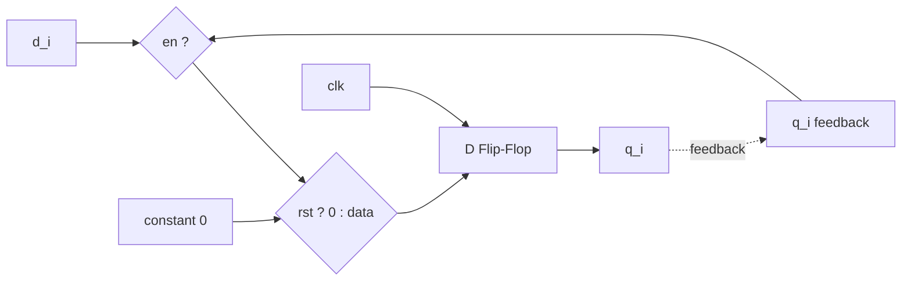
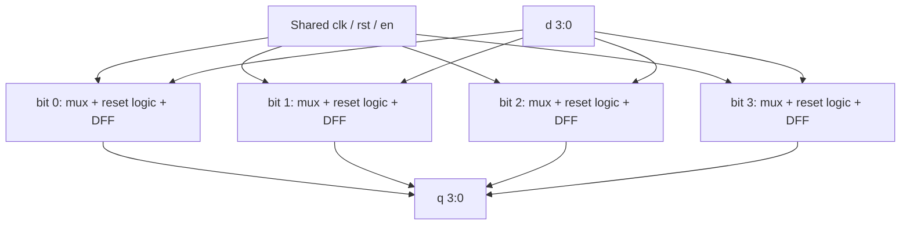
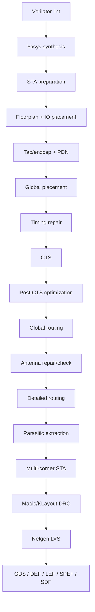
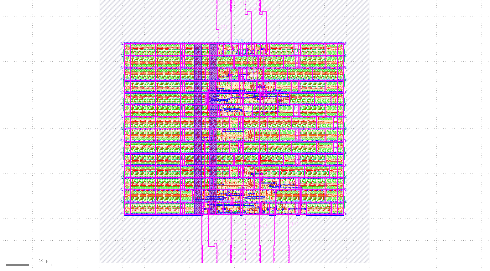
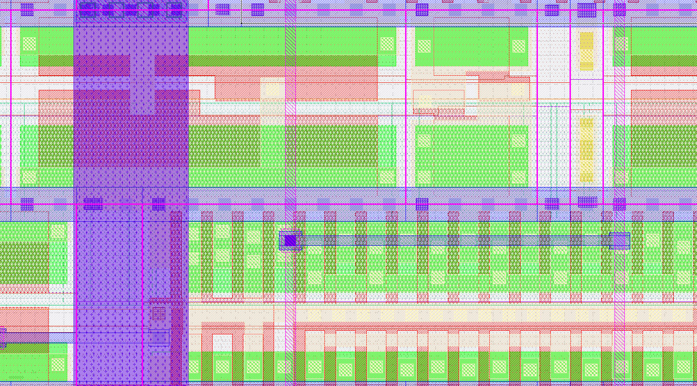
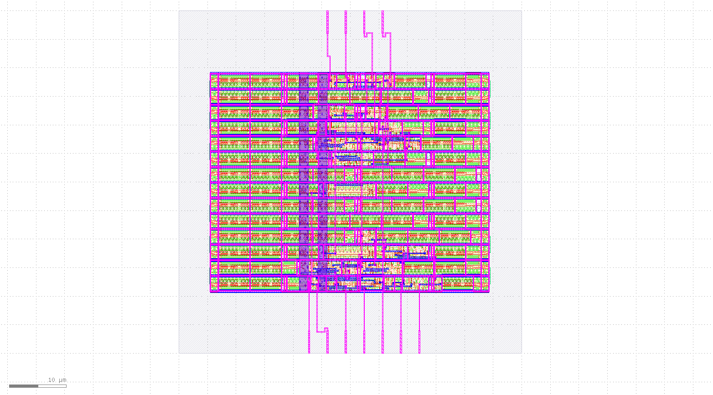
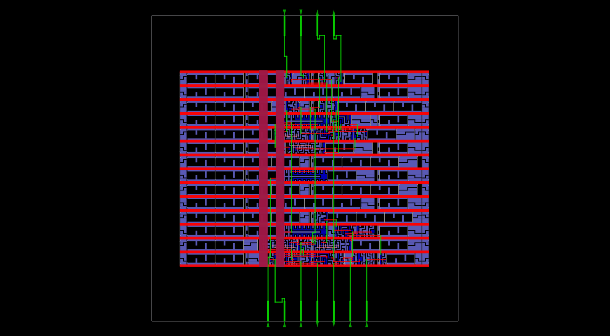
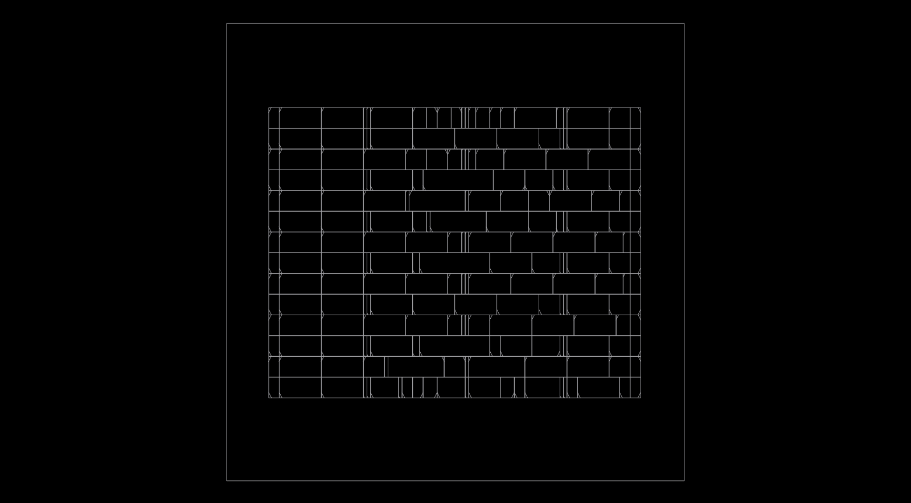

# 4-bit Register：從 SystemVerilog RTL、Testbench 到 SKY130 GDS 的完整實作

> 實作日期：2026-11-17  
> 實作環境：WSL2、Ubuntu 22.04、Icarus Verilog 11.0、OpenLane 2（Nix 環境）、SKY130、OpenROAD、KLayout 0.29.4  
> 建議放置位置：`~/projects/register4-rtl-to-gds`  
> 最終驗證 run：`RUN_2026-11-17_17-34-34`

這份文件從零開始說明如何安裝工具、建立與驗證一個 4-bit register，再把 RTL 經過 synthesis、floorplan、PDN、placement、CTS、routing、STA、DRC、LVS，最後產生 GDS。內容不是只列指令，也會解釋每個步驟為什麼存在、指令各參數的意思、GUI 如何操作，以及換成另一個 RTL 設計時需要修改什麼。

本範例的實際結果：

- SystemVerilog self-checking testbench：`9/9` 通過。
- OpenLane Classic flow：`78/78` stages 完成。
- Setup violations：0；worst setup slack：`+6.2499 ns`。
- Hold violations：0；worst hold slack：`+0.4628 ns`。
- OpenROAD routing DRC、Magic DRC、KLayout DRC：皆為 0。
- LVS：`Circuits match uniquely`。
- Antenna violations、disconnected pins、max slew/cap violations：皆為 0。

這仍是教學型 RTL-to-GDS 範例，不應稱為量產 tape-out signoff。原因詳見「限制與誠實邊界」。

### 快速開始

Repository 已整理成可獨立移動或上傳的結構：

```text
register4-rtl-to-gds/
├── README.md
├── rtl/register4.sv
├── tb/register4_tb.sv
├── openlane/config.json
├── docs/images/
└── results/
    ├── metrics.json
    ├── sta_summary.rpt
    ├── lvs.rpt
    └── register4.gds
```

從 repository 根目錄執行 RTL 測試：

```bash
iverilog -g2012 -Wall -s register4_tb \
  -o register4_sim rtl/register4.sv tb/register4_tb.sv
vvp register4_sim
```

進入 OpenLane 2 的 Nix shell 後執行 RTL-to-GDS：

```bash
python3 -m json.tool openlane/config.json
openlane openlane/config.json
```

`results/` 是已驗證 run 的精選證據；重新執行產生的完整 `openlane/runs/` 已由 `.gitignore` 排除。

---

## 目錄

1. [先理解三個不同階段](#1-先理解三個不同階段)
2. [環境需求與工具角色](#2-環境需求與工具角色)
3. [從零安裝 OpenLane 2](#3-從零安裝-openlane-2)
4. [Terminal 基本操作](#4-terminal-基本操作)
5. [4-bit register 規格與真值表](#5-4-bit-register-規格與真值表)
6. [數位邏輯架構](#6-數位邏輯架構)
7. [撰寫 RTL](#7-撰寫-rtl)
8. [撰寫 self-checking testbench](#8-撰寫-self-checking-testbench)
9. [RTL 模擬與波形](#9-rtl-模擬與波形)
10. [建立 OpenLane 專案](#10-建立-openlane-專案)
11. [理解 config.json](#11-理解-configjson)
12. [執行 RTL-to-GDS](#12-執行-rtl-to-gds)
13. [第一次 PDN 失敗與修正](#13-第一次-pdn-失敗與修正)
14. [OpenLane 做了哪些工作](#14-openlane-做了哪些工作)
15. [最終產物與實際結果](#15-最終產物與實際結果)
16. [KLayout GUI 完整操作](#16-klayout-gui-完整操作)
17. [OpenROAD GUI 與 Tcl 完整操作](#17-openroad-gui-與-tcl-完整操作)
18. [五張圖片的用途](#18-五張圖片的用途)
19. [換成另一個 RTL 設計](#19-換成另一個-rtl-設計)
20. [常見錯誤與判讀方式](#20-常見錯誤與判讀方式)
21. [限制與誠實邊界](#21-限制與誠實邊界)
22. [完整重現清單](#22-完整重現清單)

---

## 1. 先理解三個不同階段

這個練習其實包含三種不同工作，不能混在一起：


### 1.1 RTL 設計

RTL 描述「時脈邊緣到來時，暫存器應該做什麼」，而不是描述每條金屬線的位置。

### 1.2 功能驗證

Testbench 驗證 reset、enable、capture、hold 是否符合規格。這一步若失敗，不應繼續做 layout。

### 1.3 Physical design

OpenLane/OpenROAD 把已驗證的 RTL 轉成 standard cells，完成放置與繞線，再輸出 GDS。數位 physical design 通常由指令、設定檔和 Tcl 控制流程，GUI 用來觀察與除錯；不會逐顆手動畫所有電晶體。

如果是在 VLSI 課程中手動畫 diffusion、poly、metal 和 contact，那屬於 full-custom layout。這次則是 standard-cell based digital layout。Standard-cell 內部仍然有彩色的 diffusion/poly/metal，只是那些 cell 由 SKY130 library 事先設計好。

---

## 2. 環境需求與工具角色

本機實際環境：

| 項目 | 實際環境 |
|---|---|
| Host | Windows + WSL2 |
| Linux | Ubuntu 22.04.5 LTS |
| RAM | 約 15 GiB |
| 可用空間 | 約 884 GiB（安裝當時） |
| GUI | WSLg，`DISPLAY=:0`、`WAYLAND_DISPLAY=wayland-0` |
| RTL simulator | Icarus Verilog 11.0 |
| Waveform viewer | GTKWave |
| ASIC flow | OpenLane 2 |
| Synthesis | Yosys |
| Placement/routing/STA | OpenROAD / OpenSTA |
| Layout viewer | KLayout、Magic |
| PDK | SKY130 |

各工具的角色：

| 工具 | 用途 |
|---|---|
| VS Code | 編輯文字；本身不是 compiler |
| `iverilog` | 編譯 Verilog/SystemVerilog RTL 與 testbench |
| `vvp` | 執行 Icarus 編譯後的模擬檔 |
| GTKWave | 查看 VCD 波形 |
| Yosys | 把 RTL 合成為 gate-level netlist |
| OpenROAD | floorplan、PDN、placement、CTS、routing、STA |
| Magic/KLayout | DRC、stream-out 與 GDS 檢視 |
| Netgen | LVS，比對 layout 與電路/netlist |
| Nix | 提供版本固定、可重現的 OpenLane 工具環境 |

OpenLane 官方文件：

- [OpenLane 2 installation overview](https://openlane2.readthedocs.io/en/stable/getting_started/installation_overview.html)
- [Ubuntu/Nix installation](https://openlane2.readthedocs.io/en/latest/getting_started/common/nix_installation/installation_linux.html)
- [OpenLane newcomers guide](https://openlane2.readthedocs.io/en/stable/getting_started/newcomers/index.html)

---

## 3. 從零安裝 OpenLane 2

### 3.1 安裝 RTL 模擬工具與基本工具

在 WSL Ubuntu terminal 中執行：

```bash
sudo apt-get update
sudo apt-get install -y curl git iverilog gtkwave
```

參數說明：

- `sudo`：以系統管理權限執行。
- `apt-get update`：更新 Ubuntu 套件索引，不是升級所有軟體。
- `apt-get install`：安裝套件。
- `-y`：自動回答 yes。
- `curl`：下載 Nix installer。
- `git`：下載 OpenLane source repository。
- `iverilog`、`gtkwave`：RTL simulation 與 waveform viewer。

確認：

```bash
iverilog -V
git --version
curl --version
```

### 3.2 安裝 Nix

不要使用 `apt install nix`；OpenLane 官方提醒 Ubuntu repository 的 Nix 版本可能過舊。使用官方建議的 installer 並加入 OpenLane binary cache：

```bash
curl --proto '=https' --tlsv1.2 -sSf -L https://install.determinate.systems/nix | \
sh -s -- install --no-confirm --extra-conf "
extra-substituters = https://openlane.cachix.org
extra-trusted-public-keys = openlane.cachix.org-1:qqdwh+QMNGmZAuyeQJTH9ErW57OWSvdtuwfBKdS254E=
"
```

這條指令的重點：

- `--proto '=https'`：只允許 HTTPS。
- `--tlsv1.2`：要求 TLS 1.2 或以上。
- `-sSfL`：安靜下載、錯誤時失敗、跟隨 redirect。
- `| sh`：把下載的官方 installer 交給 shell 執行；因此來源網址必須核對。
- `extra-substituters` 與 public key：允許使用 OpenLane Cachix 的預建 binary，避免本機從頭編譯整套 EDA 工具。

安裝完成後，先儲存工作，再在每個 WSL shell 執行：

```bash
exit
```

關閉連到 WSL 的 VS Code/Ubuntu terminal，重新開啟後確認：

```bash
nix --version
```

若仍然找不到 `nix`，可在 Windows PowerShell 執行：

```powershell
wsl --shutdown
```

再重新開啟 WSL。這不需要重新開機，但會停止當時所有 WSL processes，所以要先保存檔案。

### 3.3 Clone OpenLane 2

工具與自己的 project 分開放：

```bash
mkdir -p ~/tools
git clone https://github.com/efabless/openlane2 ~/tools/openlane2
```

其中：

- `mkdir -p`：建立目錄；父目錄已存在也不報錯。
- `git clone URL PATH`：把 repository 複製到指定位置。

### 3.4 進入 OpenLane 環境

```bash
nix-shell --pure ~/tools/openlane2/shell.nix
```

- `nix-shell`：依 `shell.nix` 建立工具環境。
- `--pure`：盡量隔離外部環境變數，降低版本互相污染。
- 進入後 prompt 會變成 `[nix-shell:目前路徑]$`。
- 這不是 Python `.venv`，也不需要再建立 `.venv`。

第一次大約會下載數 GiB。進入後執行 smoke test：

```bash
openlane --log-level ERROR --condensed --show-progress-bar --smoke-test
```

本機實際結果：

```text
135 passed, 2 skipped
Classic - Stage 78 - Report Manufacturability 78/78
```

`2 skipped` 不是失敗；pytest 中 skipped 表示該環境下有條件地略過測試。

確認工具：

```bash
command -v openlane openroad yosys klayout magic netgen
```

在 Nix 環境內應顯示 `/nix/store/...` 路徑。結束時輸入：

```bash
exit
```

下次使用時重新執行：

```bash
nix-shell --pure ~/tools/openlane2/shell.nix
```

---

## 4. Terminal 基本操作

### 4.1 常用路徑符號

| 符號 | 意義 |
|---|---|
| `~` | 目前使用者的 home，例如 `/home/your-user` |
| `.` | 目前目錄 |
| `..` | 上一層目錄 |
| `/` 開頭 | absolute path |
| 沒有 `/` 開頭 | relative path |

### 4.2 常用指令

```bash
pwd                 # 顯示目前位置
ls -l               # 列出檔案及詳細資訊
mkdir -p A/B        # 建立 A/B 及必要的父目錄
cd A/B              # 進入 A/B
cp source.sv .      # 把檔案複製到目前目錄
touch config.json   # 建立空檔案，已存在時更新時間
/usr/bin/nano file  # 在 terminal 內編輯檔案
```

只輸入一段路徑，例如：

```bash
~/projects/register4-rtl-to-gds/
```

Bash 會把它當成「要執行的程式」，不會建立或進入目錄。正確做法：

```bash
mkdir -p ~/projects/register4-rtl-to-gds
cd ~/projects/register4-rtl-to-gds
```

### 4.3 nano 儲存方式

```bash
/usr/bin/nano config.json
```

編輯完成後：

1. `Ctrl+O`：Write Out，儲存。
2. `Enter`：確認檔名。
3. `Ctrl+X`：離開。

---

## 5. 4-bit register 規格與真值表

### 5.1 介面

| Signal | 寬度 | 方向 | 意義 |
|---|---:|---|---|
| `clk` | 1 | input | 上升緣觸發時脈 |
| `rst` | 1 | input | active-high synchronous reset |
| `en` | 1 | input | clock enable |
| `d` | 4 | input | 待寫入資料 |
| `q` | 4 | output | 暫存資料 |

### 5.2 行為規格

只有 `posedge clk` 到來時才更新 `q`：

1. `rst=1`：`q` 清為 `0000`。
2. 否則若 `en=1`：`q` 擷取 `d`。
3. 否則：`q` 保持原值。

Reset 的優先權高於 Enable。

### 5.3 Next-state table

Register 是 sequential circuit，因此比一般 combinational truth table 多了 current state `q(t)` 與 next state `q(t+1)`：

| Clock event | `rst` | `en` | `d` | `q(t+1)` | 動作 |
|---|---:|---:|---|---|---|
| `posedge clk` | 1 | X | XXXX | 0000 | synchronous reset |
| `posedge clk` | 0 | 1 | DDDD | DDDD | capture |
| `posedge clk` | 0 | 0 | XXXX | `q(t)` | hold |
| 非 `posedge` | X | X | XXXX | `q(t)` | 不更新 |

`X` 在此表表示 don't care，不是模擬中的 unknown value。

對單一 bit，可展開為：

| `rst` | `en` | `d_i` | `q_i(t)` | `q_i(t+1)` |
|---:|---:|---:|---:|---:|
| 1 | X | X | X | 0 |
| 0 | 1 | 0 | X | 0 |
| 0 | 1 | 1 | X | 1 |
| 0 | 0 | X | 0 | 0 |
| 0 | 0 | X | 1 | 1 |

Next-state equation：

```text
q_i(t+1) = rst ? 0 : (en ? d_i : q_i(t))
```

等價布林式：

```text
q_i(t+1) = ~rst & ((en & d_i) | (~en & q_i(t)))
```

---

## 6. 數位邏輯架構

### 6.1 每一個 bit 的概念



4-bit register 就是把這個 data path 平行複製四份，四個 DFF 共用 `clk`、`rst`、`en`。



### 6.2 實際 synthesis mapping

LVS report 顯示主要邏輯被映射為：

| SKY130 cell | 數量 | 用途 |
|---|---:|---|
| `sky130_fd_sc_hd__dfxtp_1` | 4 | 4 個 D flip-flops |
| `sky130_fd_sc_hd__mux2_1` | 4 | enable data/feedback 選擇 |
| `sky130_fd_sc_hd__and2b_1` | 4 | reset/next-state 邏輯的一部分 |
| `sky130_fd_sc_hd__clkbuf_16` | 3 | clock tree buffers |
| `sky130_fd_sc_hd__buf_2` | 4 | output buffers |

此外 OpenROAD 為 timing、hold、clock、fill、tap 等實體需求插入額外 cells。RTL 只描述功能；synthesis 和 physical design 會決定實際 standard-cell 組合。

---

## 7. 撰寫 RTL

RTL source：[`rtl/register4.sv`](rtl/register4.sv)

核心 RTL：

```systemverilog
`timescale 1ns/1ps

module register4 (
    input  logic       clk,
    input  logic       rst,
    input  logic       en,
    input  logic [3:0] d,
    output logic [3:0] q
);

    always_ff @(posedge clk) begin
        if (rst) begin
            q <= 4'b0000;
        end
        else if (en) begin
            q <= d;
        end
    end

endmodule
```

### 7.1 為什麼用 `always_ff`

`always_ff @(posedge clk)` 明確表示這是 edge-triggered sequential logic。使用 `.sv` 與 `-g2012` 才能使用 SystemVerilog 的 `logic`、`always_ff`。

### 7.2 為什麼用 nonblocking assignment `<=`

Sequential logic 應使用 `<=`，讓所有暫存器在同一 simulation time step 根據更新前的狀態計算，再一起提交新值。若混用 blocking assignment `=`，容易產生 simulation race 或與硬體意義不一致。

### 7.3 為什麼沒有最後一個 `else`

在 clocked `always_ff` 中，若 `rst=0` 且 `en=0` 沒有賦值，DFF 會保留原值。這正是 clock enable/hold 的行為，不是 latch。

### 7.4 Synchronous reset 的重點

`rst` 不在 sensitivity list 中：

```systemverilog
always_ff @(posedge clk)
```

因此 `rst` 在兩個 clock edges 之間改變時，`q` 不會立刻清零；必須等下一個 `posedge clk`。

---

## 8. 撰寫 self-checking testbench

Testbench：[`tb/register4_tb.sv`](tb/register4_tb.sv)

Testbench 不只印波形，而會自動比較 expected value，錯誤時用 `$fatal` 結束。

核心結構：

```systemverilog
`timescale 1ns/1ps

module register4_tb;

    logic clk = 1'b0;
    logic rst = 1'b0;
    logic en  = 1'b0;
    logic [3:0] d = 4'b0000;
    wire  [3:0] q;
    integer pass_count;

    register4 dut (
        .clk(clk),
        .rst(rst),
        .en(en),
        .d(d),
        .q(q)
    );

    always #5 clk = ~clk;

    task check_q;
        input [3:0] expected;
        begin
            if (q !== expected) begin
                $fatal(1,
                    "FAIL t=%0t rst=%b en=%b d=%h q=%h expected=%h",
                    $time, rst, en, d, q, expected);
            end

            $display(
                "PASS t=%0t rst=%b en=%b d=%h q=%h",
                $time, rst, en, d, q
            );
            pass_count = pass_count + 1;
        end
    endtask

    initial begin
        pass_count = 0;
        $dumpfile("register4.vcd");
        $dumpvars(0, register4_tb);

        // 1. rst=1 與 en=1 同時存在：reset 優先。
        rst = 1'b1;
        en  = 1'b1;
        d   = 4'hA;
        @(posedge clk); #1; check_q(4'h0);

        // 2. negedge 改輸入，posedge 前 q 不應改變。
        @(negedge clk);
        rst = 1'b0;
        en  = 1'b1;
        d   = 4'hA;
        #1; check_q(4'h0);

        // 3. posedge capture A。
        @(posedge clk); #1; check_q(4'hA);

        // 4-5. en=0：改 d 仍保持 A，經過 posedge 也保持。
        @(negedge clk);
        en = 1'b0;
        d  = 4'h3;
        #1; check_q(4'hA);
        @(posedge clk); #1; check_q(4'hA);

        // 6-7. en=1：posedge 前仍是 A，posedge 後 capture 5。
        @(negedge clk);
        en = 1'b1;
        d  = 4'h5;
        #1; check_q(4'hA);
        @(posedge clk); #1; check_q(4'h5);

        // 8-9. synchronous reset：assert 後不立刻改，posedge 才清零。
        @(negedge clk);
        rst = 1'b1;
        en  = 1'b0;
        #1; check_q(4'h5);
        @(posedge clk); #1; check_q(4'h0);

        if (pass_count != 9)
            $fatal(1, "Incomplete test: %0d/9", pass_count);

        $display("REGISTER4 TEST PASS: 9/9");
        $finish;
    end

endmodule
```

### 8.1 為什麼 clock 是 `always #5`

每 5 ns 反相一次，因此完整週期是 10 ns：

```text
0 ns:  clk=0
5 ns:  clk=1  ← posedge
10 ns: clk=0  ← negedge
15 ns: clk=1  ← posedge
```

10 ns period 對應 100 MHz：

```text
frequency = 1 / 10 ns = 100 MHz
```

### 8.2 為什麼 `posedge` 後加 `#1`

RTL 使用 nonblocking assignment。`@(posedge clk)` 剛返回時，NBA update 可能尚未提交；等 1 ns 再檢查可避免 testbench 在更新前取樣。

### 8.3 為什麼用 `!==`

`!==` 是 case inequality，會把 `X`、`Z` 也視為明確不相等。若輸出沒有初始化或連接錯誤，測試不會把 unknown 誤判成正常。

### 8.4 Testbench 為何不能送進 OpenLane

以下結構只用於 simulation，不能合成為晶片：

- `initial`
- `always #5`
- `#1`
- `$dumpfile`、`$dumpvars`
- `$display`、`$fatal`、`$finish`

OpenLane 的 `VERILOG_FILES` 只能包含 synthesizable design RTL，不可包含 testbench。

---

## 9. RTL 模擬與波形

### 9.1 進入原始 RTL/TB 目錄

```bash
cd ~/projects/register4-rtl-to-gds
```

### 9.2 編譯

```bash
iverilog -g2012 -Wall -s register4_tb \
  -o register4_sim rtl/register4.sv tb/register4_tb.sv
```

參數：

| 參數 | 意義 |
|---|---|
| `-g2012` | 啟用 SystemVerilog 2012 語法 |
| `-Wall` | 顯示常見 warnings |
| `-s register4_tb` | 指定 simulation top module |
| `-o register4_sim` | 指定輸出 executable/simulation image 名稱 |
| 最後兩個檔名 | 要一起編譯的 design 與 TB |

編譯與執行是兩件事。`iverilog` 成功只代表語法/elaboration 通過；功能仍要交給 `vvp` 執行。

### 9.3 執行

```bash
vvp register4_sim
```

實際驗證輸出：

```text
PASS t=6000 rst=1 en=1 d=a q=0
PASS t=11000 rst=0 en=1 d=a q=0
PASS t=16000 rst=0 en=1 d=a q=a
PASS t=21000 rst=0 en=0 d=3 q=a
PASS t=26000 rst=0 en=0 d=3 q=a
PASS t=31000 rst=0 en=1 d=5 q=a
PASS t=36000 rst=0 en=1 d=5 q=5
PASS t=41000 rst=1 en=0 d=5 q=5
PASS t=46000 rst=1 en=0 d=5 q=0
REGISTER4 TEST PASS: 9/9
```

### 9.4 看波形

```bash
gtkwave register4.vcd
```

在 GTKWave 加入 `clk`、`rst`、`en`、`d[3:0]`、`q[3:0]`。應觀察：

- `q` 只在 `posedge clk` 改變。
- `en=0` 時維持原值。
- `rst=1` 不會在 negedge 立刻清零，下一個 posedge 才清零。

---

## 10. 建立 OpenLane 專案

這個 repository 已經包含 RTL、TB 和 OpenLane config，不必再從其他練習目錄複製檔案。先進入 repository 根目錄：

```bash
cd ~/projects/register4-rtl-to-gds
```

確認必要檔案：

```bash
ls -l rtl/register4.sv tb/register4_tb.sv openlane/config.json
```

再進入 OpenLane Nix shell：

```bash
nix-shell --pure ~/tools/openlane2/shell.nix
```

prompt 應變成類似：

```text
[nix-shell:~/projects/register4-rtl-to-gds]$
```

`openlane/config.json` 只引用 synthesizable RTL；不要把 `tb/register4_tb.sv` 加入 `VERILOG_FILES`。

---

## 11. 理解 config.json

本次實際設定檔：[`openlane/config.json`](openlane/config.json)

```json
{
  "DESIGN_NAME": "register4",
  "VERILOG_FILES": ["dir::../rtl/register4.sv"],
  "CLOCK_PORT": "clk",
  "CLOCK_PERIOD": 10,
  "FP_SIZING": "absolute",
  "DIE_AREA": [0, 0, 60, 60]
}
```

逐項說明：

### `DESIGN_NAME`

```json
"DESIGN_NAME": "register4"
```

指定 synthesis/physical-design top module。必須與 RTL 中的：

```systemverilog
module register4 (...);
```

一致。它不是 testbench module 名稱。

### `VERILOG_FILES`

```json
"VERILOG_FILES": ["dir::../rtl/register4.sv"]
```

指定 synthesizable source。`dir::` 表示以 `config.json` 所在目錄為基準解析路徑，因此不依賴執行 terminal 的 cwd。

多檔案設計可寫：

```json
"VERILOG_FILES": [
  "dir::../rtl/package.sv",
  "dir::../rtl/submodule.sv",
  "dir::../rtl/top.sv"
]
```

### `CLOCK_PORT`

```json
"CLOCK_PORT": "clk"
```

告訴 flow 哪個 top-level port 是 clock。若名稱寫錯，CTS 與 timing constraints 就會錯。

### `CLOCK_PERIOD`

```json
"CLOCK_PERIOD": 10
```

單位為 ns；10 ns 等於 100 MHz。這是 timing target，不是由 testbench 自動匯入。TB 的 10 ns clock 與 config 的 10 ns 是刻意保持一致，但兩者屬於不同工具設定。

### `FP_SIZING`

```json
"FP_SIZING": "absolute"
```

要求 floorplan 使用手動指定的 die area，而非只靠 cell area/utilization 自動估算。

### `DIE_AREA`

```json
"DIE_AREA": [0, 0, 60, 60]
```

座標為 `[x0, y0, x1, y1]`，單位 µm，因此本例是 60 µm × 60 µm。這個尺寸是為了讓極小的 register demo 能容納預設 PDN straps，不是所有設計都應照抄 60 × 60。

驗證 JSON 格式：

```bash
python3 -m json.tool openlane/config.json
```

若少逗號、括號不匹配或引號錯誤，這個指令會指出位置。

---

## 12. 執行 RTL-to-GDS

確認 prompt 仍以 `[nix-shell:...]$` 開頭，然後在 project 目錄執行：

```bash
openlane openlane/config.json
```

這不是只做 layout viewer，而是啟動完整 flow。成功結果：

```text
[INFO] Flow complete.
Classic - Stage 78 - Report Manufacturability 78/78
```

每次執行會在 `openlane/runs/` 內建立新的 timestamp directory，例如：

```text
openlane/runs/RUN_2026-11-17_17-34-34/
```

失敗的舊 run 不需要刪除；保留它能追蹤錯誤與修正。新執行會建立新的 run。

---

## 13. 第一次 PDN 失敗與修正

### 13.1 第一次最小設定

一開始只有：

```json
{
  "DESIGN_NAME": "register4",
  "VERILOG_FILES": ["dir::../rtl/register4.sv"],
  "CLOCK_PORT": "clk",
  "CLOCK_PERIOD": 10
}
```

OpenLane 依 cell area 與預設 utilization 自動估出很小的 core。由於 register4 只有少量邏輯，core 寬度只有 17.94 µm。

### 13.2 錯誤

```text
[PDN-0185] Insufficient width (17.94 um) to add straps on layer met4
in grid "stdcell_grid" with total strap width 4.9 um and offset 16.32 um.
```

這不是 RTL 錯誤，也不是「Verilog 無法 synthesis」。Flow 已經完成 synthesis、floorplan 等前面階段，直到 PDN generation 才發現預設 met4 power straps 放不進 core。

### 13.3 為什麼會失敗

PDN 需要：

- power strap 的寬度與間距；
- 距離 core boundary 的 offset；
- 足夠的水平/垂直面積。

當 core 比 `offset + strap width` 還窄，幾何上無法合法放入電源網格。

### 13.4 修正

加入：

```json
"FP_SIZING": "absolute",
"DIE_AREA": [0, 0, 60, 60]
```

重跑後 PDN 成功，最後完成 78/78 stages。

### 13.5 一般化判斷

若換成別的設計遇到同一錯誤，不應盲目把 die 放很大。可考慮：

1. 對極小教學設計使用合理的 absolute die area。
2. 降低 `FP_CORE_UTIL`，讓 relative floorplan 變大。
3. 依真正 power requirement 調整 PDN config。
4. 檢查 cell count、I/O 數量與 aspect ratio。

本例選 60 × 60 µm 是為了入門流程清楚且穩定，不代表經過 area/power optimization。

---

## 14. OpenLane 做了哪些工作

完整流程概念：



### 14.1 Lint

先找語法與 coding-style 問題。本次 `design__lint_error__count = 0`。

441 warnings 全部屬於：

```text
%Warning-TIMESCALEMOD
```

原因是 `register4.sv` 有 `` `timescale``，SKY130 library black-box modules 沒有相同 timescale。這不是 441 個 RTL 邏輯錯誤，也沒有阻止 flow。

### 14.2 Synthesis

Yosys 把 `always_ff` 與條件邏輯映射成 mux、gates、DFF。結果沒有 unmapped cells 或 synthesis check errors。

### 14.3 Floorplan 與 PDN

決定 die/core 邊界、row、I/O pin 位置和 power distribution network。

### 14.4 Placement

把 standard cells 放到 legal rows。Placement 不是把 RTL block 隨意畫成方塊，而是要符合 site grid、orientation、density 和 timing。

### 14.5 CTS

Clock Tree Synthesis 插入 clock buffers，把 clock 分配到四個 DFF，控制 insertion delay 與 skew。

### 14.6 Routing

Global routing 先規劃通道，detailed routing 再產生符合 design rules 的 metal/via geometry。

### 14.7 RC extraction 與 STA

抽取 routing parasitics，針對不同 process/voltage/temperature corners 做 setup/hold timing analysis。

### 14.8 DRC、LVS、Antenna

- DRC：版圖幾何是否違反製程寬度、間距、包覆等規則。
- LVS：layout 抽取電路是否與 netlist connectivity 相符。
- Antenna：製程中長導線累積電荷是否可能傷害 gate oxide。

---

## 15. 最終產物與實際結果

### 15.1 Final directory

```text
openlane/runs/RUN_2026-11-17_17-34-34/final/
├── def/register4.def
├── gds/register4.gds
├── klayout_gds/register4.klayout.gds
├── lef/register4.lef
├── lib/
├── mag/register4.mag
├── nl/register4.nl.v
├── odb/register4.odb
├── pnl/register4.pnl.v
├── sdc/register4.sdc
├── sdf/
├── spef/
├── spice/register4.spice
├── metrics.csv
└── metrics.json
```

主要格式：

| 格式 | 用途 |
|---|---|
| GDS | 最終幾何版圖交換格式 |
| DEF | placement、routing 等 physical implementation |
| LEF | block abstract，供上層整合 |
| ODB | OpenROAD database |
| `nl.v` | gate-level netlist，不含 explicit power pins |
| `pnl.v` | powered netlist |
| SDC | timing constraints |
| SDF | cell/interconnect delay annotation |
| SPEF | extracted parasitic RC |
| SPICE | layout extraction/LVS 相關電路表示 |

### 15.2 Physical metrics

| Metric | 實際值 |
|---|---:|
| Die bbox | `0 0 60 60 µm` |
| Core bbox | `5.52 10.88 54.28 48.96 µm` |
| Die area | `3600 µm²` |
| Core area | `1856.78 µm²` |
| Std-cell instances | 53 |
| Std-cell area | `351.587 µm²` |
| Instance utilization | `18.9353%` |
| Sequential cells | 4 |
| Multi-input combinational cells | 8 |
| Clock buffers | 3 |
| Timing-repair buffers | 14 |
| Hold buffers | 4 |
| Fill cells | 167 |
| Tap cells | 24 |
| Routed wirelength | `434 µm` |
| Vias | 140 |

Fill/tap cells 不包含在 RTL 功能邏輯中，但對 well continuity、power integrity、density 與製程實作很重要。

### 15.3 Timing summary

| Timing check | Worst slack | Violation count |
|---|---:|---:|
| Setup | `+6.2499 ns` | 0 |
| Hold | `+0.4628 ns` | 0 |
| Max slew | — | 0 |
| Max capacitance | — | 0 |

Worst setup path：

```text
Corner: max_ss_100C_1v60
Startpoint: _16_ (sky130_fd_sc_hd__dfxtp_1)
Endpoint: q[0]
Data arrival time: 1.500090 ns
Data required time: 7.750000 ns
Slack: 6.249910 ns (MET)
```

Setup slack 定義：

```text
slack = required time - arrival time
      = 7.750000 - 1.500090
      = 6.249910 ns
```

正 slack 代表 timing met；負 slack 才是 violation。

### 15.4 Physical verification

| 檢查 | 結果 |
|---|---:|
| OpenROAD routing DRC | 0 |
| Magic DRC | 0 |
| KLayout DRC | 0 |
| LVS device/net/pin mismatch | 0 |
| LVS final result | `Circuits match uniquely` |
| Antenna violating nets/pins | 0 / 0 |
| Disconnected pins | 0 |

證據位置：

- [`results/metrics.json`](results/metrics.json)
- [`results/sta_summary.rpt`](results/sta_summary.rpt)
- [`results/lvs.rpt`](results/lvs.rpt)
- [`results/register4.gds`](results/register4.gds)

這些是成功 run 的精選副本。自己重跑時，完整產物會出現在 `openlane/runs/<RUN_TAG>/`。

---

## 16. KLayout GUI 完整操作

KLayout 適合看最終 GDS polygon、layers、standard-cell 內部 diffusion/poly/metal，以及 DRC markers。

官方參考：

- [KLayout basic manual](https://www.klayout.de/doc/manual/basic.html)
- [Hierarchy depth](https://klayout.de/doc/manual/hier.html)
- [Creating a screenshot](https://www.klayout.de/doc/manual/screenshots.html)

### 16.1 開啟最新 run

在 project directory、Nix shell 中：

```bash
openlane --last-run --flow openinklayout openlane/config.json
```

指令解釋：

- `--last-run`：使用此 config 最近一次 run。
- `--flow openinklayout`：不是重跑 P&R，而是用 OpenLane 正確載入 PDK layer properties 與 final GDS。
- `config.json`：讓 OpenLane 找到對應 design/run。

也可直接找到：

```text
openlane/runs/<RUN_TAG>/final/gds/register4.gds
```

但直接開啟時可能缺少 OpenLane 預設的 layer setup，因此教學中優先用 `openinklayout`。

### 16.2 GUI 區域

| 區域 | 用途 |
|---|---|
| 左上 Cells | top cell 與 hierarchy |
| 左下 Levels | 顯示 hierarchy depth |
| 中央 Canvas | GDS geometry |
| 右側 Layers | layer color、fill、visibility |
| 下方 status | 游標所在 shape、layer、cell path |

### 16.3 Hierarchy 快捷鍵

先點一下中央 canvas，確保 keyboard focus 在 KLayout：

| 操作 | 意義 |
|---|---|
| `*` | Full Hierarchy |
| `+` | 多展開一層 |
| `-` | 少顯示一層 |
| `0` | Box only |
| `1` | Top level only |
| `Display → Full Hierarchy` | 不依賴鍵盤配置的選單操作 |

如果左側已顯示最大 hierarchy，例如 `Levels 0 … 2`，按 `*` 看起來可能沒有變化，這是正常的。

### 16.4 隱藏重疊文字

當畫面充滿 `sky130_fd_sc...` 等文字：

```text
View → Show Texts
```

取消勾選。這只改顯示，不會刪除 GDS text 或幾何資料。

### 16.5 Zoom 與導覽

- 滑鼠滾輪：以游標為中心 zoom in/out。
- 左上 `Back`：回到上一個視角。
- 放大全晶片中的 standard-cell row，即可看到 diffusion、poly、contact、metal、via。
- 右側 Layers 可個別隱藏 layer；先保存原始視圖再實驗，以免忘記原本狀態。

### 16.6 保存 PNG

```text
File → Screenshot
```

或按 `Print` key。這會存 layout canvas，不包含整個 desktop。

本例保存：

```text
01_klayout_initial_view.png
02_klayout_dff_cell_closeup.png
03_klayout_full_chip_clean.png
```

如果要保存「包含 menu、Cells、Layers panel」的完整 GUI 教學畫面，需另外用 Windows Snipping Tool；KLayout 的 Screenshot 主要保存 canvas。

### 16.7 看 DRC marker

本例 KLayout DRC 為 0，因此沒有 violation marker。若有 DRC report，可在 KLayout：

```text
Tools → Marker Browser
```

再開啟 run 中產生的 `.xml` report。不要只看 GDS 顏色判斷 DRC，應以正式 report/metrics 為準。

---

## 17. OpenROAD GUI 與 Tcl 完整操作

OpenROAD GUI 適合看 placement、routing、PDN、instances、nets、heat maps 與 timing 資料；不以顯示 transistor diffusion/poly 為主要目的。

官方參考：[OpenROAD GUI documentation](https://openroad.readthedocs.io/en/latest/main/src/gui/README.html)

### 17.1 開啟最新 run

```bash
openlane --last-run --flow openinopenroad openlane/config.json
```

主要區域：

| 區域 | 用途 |
|---|---|
| 中央 canvas | die、core、instances、routing |
| 左側 Display Control | layers、nets、instances、rows、heat maps |
| 右側 Inspector/Timing/Charts | 物件與 timing 資訊 |
| 底部 Scripting | 輸出 log 與 Tcl command input |

OpenROAD 底部可能出現：

```text
[WARNING GUI-0076] qglx_findConfig ...
```

這是 Qt/WSLg framebuffer format 警告。只要 GUI 已正常繪圖，它不是 P&R、STA 或 GDS error。

### 17.2 Tcl 指令要輸入在哪裡

下列 `gui::...`、`save_image`、`report_checks` 指令要輸入 OpenROAD 視窗最底部的 `TCL Commands` 輸入框，不是 WSL Bash terminal。

一次輸入一行並按 Enter。

### 17.3 保存目前 layout canvas

```tcl
save_image -width 1600 [file join $::env(HOME) projects register4-rtl-to-gds docs images 04_openroad_full_layout.png]
```

- `-width 1600`：輸出寬度 1600 pixels。
- `[file join ...]`：以目前帳號的 home 組合可攜式輸出路徑。
- 保存的是 layout canvas，不含 GUI panels。

### 17.4 保存與恢復顯示狀態

```tcl
gui::save_display_controls
```

把當前 Display Control 狀態暫存在 GUI session 中，方便稍後恢復：

```tcl
gui::restore_display_controls
```

這些指令不會改變 ODB 中的 placement/routing，只控制畫面顯示。

### 17.5 建立 placement-only 視圖

先保存原始 display state：

```tcl
gui::save_display_controls
```

隱藏 physical layers：

```tcl
gui::set_display_controls "Layers/*" visible false
```

隱藏 nets：

```tcl
gui::set_display_controls "Nets/*" visible false
```

確保 instances 可見：

```tcl
gui::set_display_controls "Instances/*" visible true
```

點 GUI 上方 `Fit`，再保存：

```tcl
save_image -width 1600 [file join $::env(HOME) projects register4-rtl-to-gds docs images 05_openroad_placement_only.png]
```

placement-only 圖中的白色長方形是 instance boundaries。它能說明 cells 如何排入 rows，但未標出每個 instance 類型，因此不能只憑這張圖指出哪四個一定是 DFF。

完成後恢復：

```tcl
gui::restore_display_controls
```

如果畫面意外全黑，也可用同一條 restore 指令復原。

### 17.6 取得 timing report

本環境可使用 OpenSTA 的 `report_checks`：

```tcl
report_checks \
  -sort_by_slack \
  -path_delay max \
  -fields {slew cap input nets fanout} \
  -format full_clock_expanded \
  -group_count 1
```

因 OpenROAD Tcl input 通常以單行送出，也可輸入：

```tcl
report_checks -sort_by_slack -path_delay max -fields {slew cap input nets fanout} -format full_clock_expanded -group_count 1
```

參數：

| 參數 | 意義 |
|---|---|
| `-sort_by_slack` | 最差 slack 優先 |
| `-path_delay max` | setup/max-delay analysis |
| `-fields {...}` | 顯示 slew、cap、net、fanout 等欄位 |
| `-format full_clock_expanded` | 展開 clock path |
| `-group_count 1` | 每個 path group 顯示一條最差路徑 |

Hold/min-delay 可改成：

```tcl
report_checks -sort_by_slack -path_delay min -fields {slew cap input nets fanout} -format full_clock_expanded -group_count 1
```

Interactive report 受目前 GUI 載入的 corner/state 影響；正式 multi-corner 結果應以：

```text
openlane/runs/<RUN_TAG>/54-openroad-stapostpnr/summary.rpt
```

以及各 corner 的 `max.rpt`、`min.rpt` 為準。

### 17.7 版本差異：不要假設所有 GUI helper 都存在

官方較新文件中可能出現：

```tcl
gui::show_worst_path -setup
```

本次 Nix-pinned OpenROAD 實際回應：

```text
[ERROR GUI-0070] invalid command name "gui::show_worst_path"
```

這不是 timing failure，只代表此 binary 沒有該 helper。先查可用指令：

```tcl
puts [lsort [info commands gui::*]]
```

不要為一個 GUI helper 重新安裝或打亂 OpenLane pinned environment；使用 `report_checks` 與已產生的 STA reports 即可。

### 17.8 Display Control 手動操作

若不想輸入 Tcl，可在左側：

1. 展開 `Layers`，切換 metal/via visibility。
2. 展開 `Nets`，切換 signal、clock、power、ground。
3. 展開 `Instances`，控制 instance 顯示。
4. 展開 `Heat Maps`，查看 placement/routing 等分析視圖；小型 register 的 heat map 資訊有限。
5. 使用上方 `Fit` 回到完整設計範圍。

GUI 顏色與線條只能協助理解，DRC/STA/LVS pass/fail 應以 report 為準。

---

## 18. 五張圖片的用途

### 18.1 KLayout：core 與 routing 概觀



這張已隱藏文字，適合說明 standard-cell rows、PDN 與 routing。雖然檔名含 `initial_view`，文件中應稱為 core overview，而不是第一次帶有重疊 labels 的畫面。

### 18.2 KLayout：standard-cell 實體圖層特寫



可觀察 diffusion、poly、contact/via 與 metal。當時游標位於 `sky130_fd_sc_hd__dfxtp_1` instance 內，但 PNG 本身沒有 cell selection marker，所以圖說應保守稱為 standard-cell close-up，而不是宣稱整張只包含一個 DFF。

### 18.3 KLayout：完整 die



完整呈現 60 × 60 µm die、core 和外圍 pins，適合作為最終 GDS 主圖。

### 18.4 OpenROAD：完整 routing



適合說明 OpenROAD 的 die/core、I/O pins、PDN、rows 與 routing 抽象視圖。

### 18.5 OpenROAD：placement only



隱藏 layers/nets 後，白色 rectangles 顯示 standard-cell instance boundaries。可與上一張並排說明 placement 和 routing 的差別。

建議教學順序：

```text
03 完整 GDS → 01 core 放大 → 02 layer 特寫
→ 04 OpenROAD routing → 05 placement-only 對照
```

---

## 19. 換成另一個 RTL 設計

以下以 `counter8` 為例。原則是「一個 design 一個 repository」，避免 RTL、TB、run、圖片與 config 混在一起。

### 19.1 建立新目錄

```bash
mkdir -p ~/projects/counter8-rtl-to-gds/{rtl,tb,openlane,docs/images,results}
cd ~/projects/counter8-rtl-to-gds
```

### 19.2 放入 RTL 與 TB

```bash
cp /path/to/counter8.sv rtl/
cp /path/to/counter8_tb.sv tb/
```

先做功能驗證：

```bash
iverilog -g2012 -Wall -s counter8_tb \
  -o counter8_sim rtl/counter8.sv tb/counter8_tb.sv
vvp counter8_sim
```

### 19.3 新 config

```json
{
  "DESIGN_NAME": "counter8",
  "VERILOG_FILES": ["dir::../rtl/counter8.sv"],
  "CLOCK_PORT": "clk",
  "CLOCK_PERIOD": 10,
  "FP_SIZING": "absolute",
  "DIE_AREA": [0, 0, 80, 80]
}
```

注意：`80 × 80` 只是示意，不應在沒有看 cell area、pin count、PDN 和 utilization 前直接照抄。可先用 relative sizing 跑一次，再依 report 調整。

### 19.4 必須修改的欄位

| 欄位 | 必須確認什麼 |
|---|---|
| `DESIGN_NAME` | 與 synthesizable top module 完全一致 |
| `VERILOG_FILES` | 包含所有 design sources，不含 TB |
| `CLOCK_PORT` | top-level clock port 名稱 |
| `CLOCK_PERIOD` | 目標 timing，而不是隨便複製 |
| floorplan | 依 cell count、I/O、PDN 調整 |

### 19.5 多檔案 hierarchical RTL

```json
{
  "DESIGN_NAME": "uart_top",
  "VERILOG_FILES": [
    "dir::../rtl/uart_rx.sv",
    "dir::../rtl/uart_tx.sv",
    "dir::../rtl/baud_gen.sv",
    "dir::../rtl/uart_top.sv"
  ],
  "CLOCK_PORT": "clk",
  "CLOCK_PERIOD": 20
}
```

`DESIGN_NAME` 是 top module；submodules 可以有多個。SystemVerilog package 若有相依順序，通常應放在使用它的 modules 之前。

### 19.6 通用執行流程

```bash
nix-shell --pure ~/tools/openlane2/shell.nix
cd ~/projects/<design-name>-rtl-to-gds
python3 -m json.tool openlane/config.json
openlane openlane/config.json
openlane --last-run --flow openinklayout openlane/config.json
openlane --last-run --flow openinopenroad openlane/config.json
```

不要只看到 `Flow complete` 就停止。至少檢查：

- lint/synthesis errors；
- unmapped cells；
- setup/hold violations；
- max slew/cap；
- routing DRC；
- Magic/KLayout DRC；
- LVS；
- antenna；
- disconnected pins；
- warnings 是否只是可接受的工具/設定限制。

---

## 20. 常見錯誤與判讀方式

### 20.1 `No such file or directory`

原因可能是目錄尚未建立、路徑拼錯，或把路徑當成 command。

```bash
pwd
ls -l
mkdir -p target/path
cd target/path
```

### 20.2 `nix: command not found`

Nix 安裝後 shell 尚未重新載入。先：

```bash
exit
```

關閉 WSL/VS Code terminals 後重開；必要時在 PowerShell：

```powershell
wsl --shutdown
```

### 20.3 `openlane: command not found`

尚未進入 Nix shell：

```bash
nix-shell --pure ~/tools/openlane2/shell.nix
```

### 20.4 JSON parse error

```bash
python3 -m json.tool openlane/config.json
```

檢查逗號、雙引號、方括號、花括號。

### 20.5 PDN-0185

極小 design 的 auto-sized core 無法容納預設 PDN straps。修正 floorplan/PDN，而不是亂改 RTL。

### 20.6 441 lint warnings

本例全部為 `TIMESCALEMOD`，不是 441 個邏輯問題。正式判讀要看 warning class，不可只看數量。

### 20.7 Generic SDC warnings

```text
'PNR_SDC_FILE' is not defined. Using generic fallback SDC.
'SIGNOFF_SDC_FILE' is not defined. Using generic fallback SDC.
```

OpenLane 依 `CLOCK_PORT`、`CLOCK_PERIOD` 與預設 I/O delay 等建立 fallback constraints。足以完成此教學，但正式專案應撰寫並審查完整 SDC。

### 20.8 `qglx_findConfig` GUI warning

若 OpenROAD GUI 已正常顯示，這通常是 WSLg/Qt framebuffer negotiation warning，不代表 P&R error。

### 20.9 `invalid command name "gui::show_worst_path"`

文件與 Nix-pinned OpenROAD 版本不同。使用：

```tcl
puts [lsort [info commands gui::*]]
```

確認可用 commands，並改用 `report_checks`/正式 STA report。

### 20.10 VS Code 沒有綠色三角形

VS Code 是 editor。Extension 主要提供 syntax highlighting、lint、IntelliSense、debug integration；compiler/simulator 是 `gcc`、`iverilog`、`openlane` 等外部工具。Terminal flow 更接近可重現的工程環境。

---

## 21. 限制與誠實邊界

此範例證明：

- RTL 行為有 self-checking TB 證據。
- RTL 能映射到 SKY130 standard cells。
- OpenLane flow 完成 placement、CTS、routing、RC extraction 與 signoff checks。
- 此 run 的 STA、DRC、LVS、antenna、connectivity metrics 通過。

但不能因此宣稱：

- 已經完成可直接量產的 ASIC。
- 已使用公司級 Cadence/Synopsys/Siemens 商用 signoff flow。
- 已完成完整 power integrity、EM、IR-drop、reliability signoff。
- 60 × 60 µm 是 area-optimal floorplan。
- 100 MHz 已在所有真實 package/board/OCV scenario 下保證。

已知限制：

1. `PNR_SDC_FILE`、`SIGNOFF_SDC_FILE` 未自訂，使用 generic fallback SDC。
2. `VSRC_LOC_FILES` 未提供，因此 IR-drop report 不足以當正式 power signoff。
3. SKY130 open PDK 與 open-source flow 適合教育/研究，不能直接等同公司 NDA PDK 與 production flow。
4. 設計只有 4-bit register，規模太小，無法代表大型 SoC 的 congestion、macro placement、clock-domain crossing、hierarchical timing closure 等難度。
5. 本次 absolute die area 是為了解決 tiny-design PDN 幾何限制，尚未做 area/power optimization sweep。

適合履歷/面試的誠實說法：

> 使用 SystemVerilog 完成具 synchronous reset 與 enable 的 4-bit register，撰寫 self-checking testbench 驗證 9 個 clock-edge cases；再使用 OpenLane 2 + SKY130 完成 RTL-to-GDS，診斷 tiny-core PDN strap placement 失敗並以 floorplan sizing 修正。最終 run 通過 multi-corner STA、OpenROAD/Magic/KLayout DRC、Netgen LVS 與 antenna/connectivity checks。此為 open-source 教學型 physical-design project，非 production tape-out。

---

## 22. 完整重現清單

### A. 安裝一次

```bash
sudo apt-get update
sudo apt-get install -y curl git iverilog gtkwave
```

依 OpenLane 官方指令安裝 Nix，重開 WSL，然後：

```bash
mkdir -p ~/tools
git clone https://github.com/efabless/openlane2 ~/tools/openlane2
nix-shell --pure ~/tools/openlane2/shell.nix
openlane --log-level ERROR --condensed --show-progress-bar --smoke-test
```

### B. RTL simulation

```bash
cd ~/projects/register4-rtl-to-gds
iverilog -g2012 -Wall -s register4_tb \
  -o register4_sim rtl/register4.sv tb/register4_tb.sv
vvp register4_sim
gtkwave register4.vcd
```

必要條件：`REGISTER4 TEST PASS: 9/9`。

### C. 檢查 repository 內容

```bash
cd ~/projects/register4-rtl-to-gds
ls -l rtl/register4.sv tb/register4_tb.sv openlane/config.json
python3 -m json.tool openlane/config.json
```

### D. RTL-to-GDS

```bash
nix-shell --pure ~/tools/openlane2/shell.nix
cd ~/projects/register4-rtl-to-gds
openlane openlane/config.json
```

必要條件：`Flow complete`、`78/78`。

### E. GUI

```bash
openlane --last-run --flow openinklayout openlane/config.json
openlane --last-run --flow openinopenroad openlane/config.json
```

兩個 GUI 是分開啟動；通常先關閉前一個 GUI，terminal 返回後再執行下一條。

### F. Signoff evidence

```bash
ls openlane/runs/*/final/metrics.json
ls openlane/runs/*/54-openroad-stapostpnr/summary.rpt
ls openlane/runs/*/68-netgen-lvs/reports/lvs.netgen.rpt
```

不要只保留圖片；`metrics.json`、STA reports、LVS report 才是可稽核的 pass/fail 證據。

---

## 最後的學習重點

這個專案最重要的不是「成功產生一張彩色 GDS」，而是建立完整工程閉環：

```text
規格
→ RTL
→ self-checking testbench
→ synthesis
→ floorplan / PDN / placement / CTS / routing
→ STA / DRC / LVS / antenna
→ 讀 report、診斷失敗、修正 config
→ 保存可重現的指令、圖片與證據
```

下一個設計應增加新問題，而不是只換 module 名稱。例如：

1. Counter：多 bit arithmetic 與 carry timing。
2. Shift register：serial path 與 enable/control。
3. FSM：state encoding、combinational next-state logic。
4. Small synchronous FIFO：read/write pointers、full/empty、memory inference。
5. UART TX/RX：較完整的 hierarchical RTL、timing constraint 與 verification。

每一個新設計都應保留相同證據鏈：simulation PASS、flow PASS、metrics、STA、DRC、LVS、GUI 圖片與限制說明。
